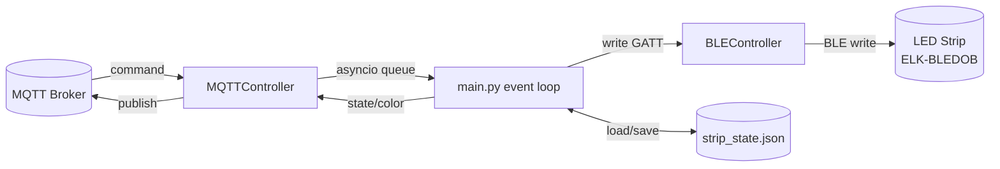

# Smart Home BLE Backend

> Python backend that bridges an MQTT broker to a Bluetooth LE LED strip, with persistent state and date-organized logging.

## Overview

`homeAppBackend` is an asyncio service that controls a BLE LED strip (an
`ELK-BLEDOB` device) over Bluetooth Low Energy in response to commands received
over MQTT. It subscribes to a command topic, translates incoming payloads into
BLE GATT writes (on/off and RGB color), and publishes the resulting device
state and color back to MQTT. The last known state and color are persisted to
disk so the strip is restored to its previous setting on the next startup.

The project is structured as a thin entry point (`main.py`) plus a small
`library` package that separates BLE control, MQTT handling, configuration, and
persistence.

## Key Features

- **MQTT-driven control** – subscribes to a command topic and publishes state
  and color updates to dedicated topics over a TLS connection.
- **BLE device control** – scans for the target device by name (or connects to
  a known address), writes GATT commands for on/off and arbitrary RGB values,
  and handles reconnection.
- **Persistent state** – stores the last on/off state and RGB color in
  `data/strip_state.json` and restores it on connect.
- **Robust reconnection** – ensures the BLE link is alive before each command
  and exits after repeated connection failures.
- **Structured logging** – logs to both stdout and a timestamped file under a
  date-organized `Logs/` directory (logs are generated at runtime).

## Tech Stack

- **Language:** Python 3 (asyncio)
- **BLE:** [`bleak`](https://github.com/hbldh/bleak) (with `dbus-fast` on Linux/BlueZ)
- **MQTT:** [`paho-mqtt`](https://www.eclipse.org/paho/) over TLS (port 8883)
- **Persistence:** JSON file on local disk
- **Logging:** standard-library `logging`

## Architecture



- `main.py` – entry point: loads persisted state, wires the BLE and MQTT
  controllers together, and runs the command loop (`handle_command`).
- `library/commands.py` – pure parsing of MQTT payloads (`get`, `on`/`off`,
  RGB tuple) and of BLE results.
- `library/config.py` – device name, characteristic UUID, command bytes, MQTT
  config, topic names, and `parse_rgb_to_bytes`.
- `library/devices.py` – `BLEController`: scan/connect, send commands,
  reconnect, and track current state/color. The bleak client and scanner are
  injectable.
- `library/mqtt.py` – `MQTTController`: subscribe, publish, and bridge messages
  into the asyncio command queue. The paho client factory is injectable.
- `library/persistence.py` – load/save strip state to JSON.
- `library/logging_setup.py` – stdout + timestamped file logging.
- `tests/` – pytest suite using fake BLE/MQTT objects (no hardware needed).

## Setup & Run

Requires Python 3 and a Bluetooth adapter on the host.

```bash
# 1. Create and activate a virtual environment
python3 -m venv .venv
source .venv/bin/activate

# 2. Install dependencies
pip install -r requirements.txt

# 3. Run the backend
python main.py
```

On Linux, `bleak` uses BlueZ via `dbus-fast`. On macOS it uses CoreBluetooth.
MQTT broker credentials and the target BLE device are defined in
`library/config.py`.

Run the tests with `pip install pytest && pytest`.

> Note: a timestamped log file is created on each run under
> `Logs/<YYYY-MM-DD>/<HH-MM-SS>.log`. These files are generated at runtime and
> are excluded from version control via `.gitignore`.

## Usage Example

With the backend running, publish commands to the configured command topic
(`home/strip/set`). Payloads are case-insensitive:

```bash
# Turn the strip on / off
mosquitto_pub -t home/strip/set -m "on"
mosquitto_pub -t home/strip/set -m "off"

# Set an RGB color (tuple of three 0-255 ints)
mosquitto_pub -t home/strip/set -m "(34, 255, 5)"

# Request the current state/color to be re-published
mosquitto_pub -t home/strip/set -m "get"
```

The backend publishes the resulting state to `home/strip/state` and color to
`home/strip/color`.

## Limitations / Next Steps

- **Configuration & secrets** are hardcoded in `library/config.py` (MQTT host,
  username, and password). Move these to environment variables or a `.env` file
  before any real deployment.
- **Single device** – the design targets one LED strip; multi-device support
  would require generalizing the controllers and topic scheme.
- **Command parsing** uses `ast.literal_eval` on incoming MQTT payloads;
  consider stricter validation/whitelisting of inputs.
- **Tests cover pure logic only** – command parsing, RGB bytes, BLE command
  mapping, the command handler and persistence run against fakes; real BLE and
  MQTT are not exercised by the suite.
- **Color persistence** stores RGB as a stringified tuple; a structured schema
  would be cleaner.
